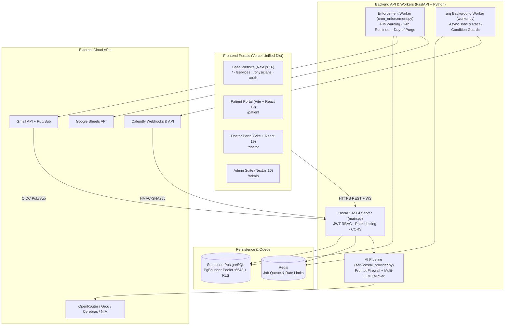
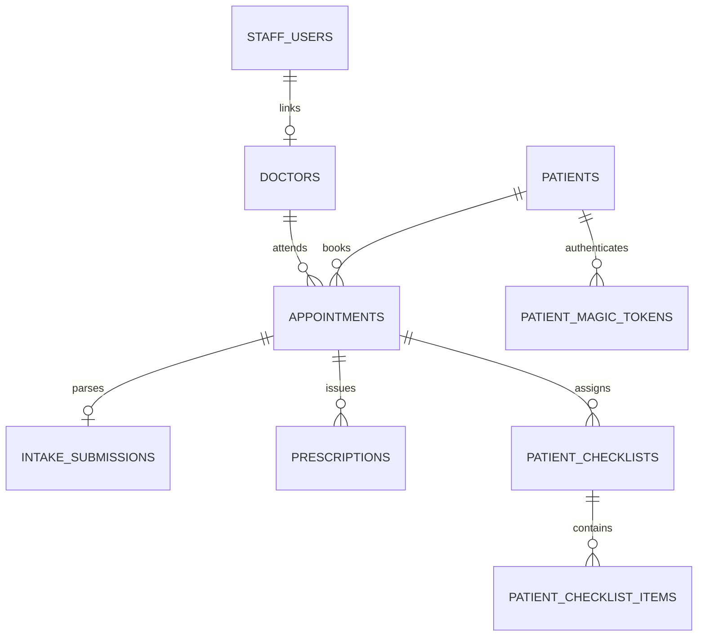

<div align="center">

# Alder & Sage — Autonomous Concierge Medical Clinic & AI Intake Platform

**Multi-portal clinical orchestration, autonomous AI triage, and scheduling enforcement built with FastAPI, Next.js 16, Vite/React 19, and Supabase PostgreSQL.**

[](https://fastapi.tiangolo.com/)
[](https://nextjs.org/)
[](https://react.dev/)
[](https://www.python.org/)
[](https://supabase.com/)
[](https://redis.io/)
[](./vercel.json)

[Architecture](#-system-architecture) •
[Portals](#-multi-portal-architecture) •
[AI Triage Pipeline](#-autonomous-ai-triage--safety) •
[Quick Start](#-quick-start) •
[API Reference](#-api--webhook-reference) •
[Docs](#-documentation-index)

</div>

---

## Overview

**Alder & Sage** automates the full clinic pre-visit lifecycle—eliminating manual intake chasing while protecting physician calendars:

- **4-Portal Experience:** Unified static-exported Vercel frontend serving Public Marketing (`/`), Patient Portal (`/patient`), Doctor Workspace (`/doctor`), and Operations Admin Suite (`/admin`).
- **Autonomous Enforcement Engine:** Background cron worker (`cron_enforcement.py`) sends **48-hour intake warnings**, **24-hour compliant reminders**, day-of **auto-cancellations** (guarded by `dry_run_mode`), and morning **doctor briefings**.
- **Resilient Multi-LLM Triage:** Extracts structured clinical intake data and completeness scores across a fallback chain (**OpenRouter → Groq → Cerebras → NVIDIA NIM / Gemini**), protected by a prompt-injection firewall.
- **Live Cloud Sync:** Synchronizes appointments into month-wise **Google Sheets**, manages **Gmail** push watches & email threads (`Ref: #<code>`), and verifies **Calendly** HMAC-SHA256 webhooks.

---

## System Architecture



---

## Multi-Portal Architecture

The `frontend/` workspace compiles four independent applications into a single deployable artifact (`frontend/dist/`) routed via [`vercel.json`](./vercel.json):

| Portal | Stack | Route | Primary Capabilities |
| :--- | :--- | :--- | :--- |
| **Base Website** | Next.js 16 (App Router), Tailwind 4, Motion | `/` | Landing pages, physician directory, services, unified Google SSO & auth callback, proactive backend wake-up probes |
| **Patient Portal** | Vite 7, React 19, Framer Motion | `/patient` | Slot booking, 3D calendar picker, intake checklists, prescription viewer, magic-link/password auth |
| **Doctor Portal** | Vite 7, React 19 | `/doctor` | Daily patient schedule, AI-parsed clinical intake summaries, e-prescription issuance, manual overrides |
| **Admin Operations** | Next.js 16 (App Router) | `/admin` | Compliance analytics, live telemetry, cron trigger & briefing history, CSV audit exports, staff/settings management |

---

## Autonomous AI Triage & Safety

<details>
<summary><strong>Click to expand AI Pipeline, Security Controls, and Database Schema</strong></summary>

### 1. Multi-Provider LLM Routing & Firewall
- **Failover Chain:** `OpenRouter` → `Groq` → `Cerebras` → `NVIDIA NIM` / `Google Gemini`, with exponential backoff on HTTP `429` (`2s → 4s → 8s`).
- **Prompt Injection Quarantine:** Inbound patient text passes through [`backend/security/firewall.py`](./backend/security/firewall.py) and [`backend/security/quarantine.py`](./backend/security/quarantine.py) before LLM execution.
- **Deterministic Identity Matching:** Normalized fuzzy matching (`0.90` threshold) resolves patient email/name variations without hallucinating missing dates or clinical values.
- **Strict Non-Diagnostic Guardrail:** Summarizes patient-reported context (`[Not provided]` for gaps); never generates medical diagnoses.

### 2. Defense-in-Depth Security
- **RBAC JWT Scopes:** Separate token guards (`get_current_patient`, `require_staff_doctor` verifying `doctor_id`, `require_admin`) in [`backend/core/security.py`](./backend/core/security.py).
- **PHI Encryption at Rest:** Sensitive medical fields encrypted via Fernet symmetric encryption (`PHI_ENCRYPTION_KEY`).
- **Supabase Row-Level Security (RLS):** Enabled across all 14 `public` tables with explicit PostgREST access policies and restricted trigger functions.
- **Webhook Integrity:** Calendly HMAC-SHA256 signature verification + `dedupe_key` idempotency against replay attacks; Google Pub/Sub OIDC token validation.

### 3. Core Database Schema (`Supabase PostgreSQL`)


</details>

---

## Quick Start

### Option 1: Docker Compose (Backend + Postgres + Redis)

```bash
cd backend
cp .env.example .env
# Configure DATABASE_URL, JWT_SECRET_KEY, and API keys in .env
docker compose up --build
```

API & Swagger Docs will be live at `http://localhost:8000/docs`.

### Option 2: Manual Local Development

<details>
<summary><strong>Step-by-step Backend & Unified Frontend Setup</strong></summary>

#### 1. Backend (`FastAPI` + `arq` + `cron`)
```bash
cd backend
python -m venv .venv
# Windows: .venv\Scripts\activate | macOS/Linux: source .venv/bin/activate
pip install -r requirements.txt
cp .env.example .env

# Run migrations / start API server
uvicorn main:app --host 0.0.0.0 --port 8000 --reload

# Optional: run background queue worker & manual daily enforcement
arq worker.QueueWorker
python cron_enforcement.py --now
```

#### 2. Frontend (All 4 Portals)
```bash
cd frontend
cp .env.example .env.local
npm install            # auto-installs dependencies across all 4 sub-apps
npm run dev            # launches Base Website, Patient, Doctor, and Admin concurrently
```

To produce the unified production bundle (`frontend/dist/`):
```bash
npm --prefix frontend run build
```

</details>

---

## Environment Configuration

<details>
<summary><strong>Click to view required Environment Variables (from <code>backend/.env.example</code>)</strong></summary>

| Variable | Description |
| :--- | :--- |
| `DATABASE_URL` | Supabase PostgreSQL transaction pooler (`:6543`) or local Postgres/SQLite URL |
| `REDIS_URL` | Redis URL for `arq` queue & rate limiting (default `redis://localhost:6379/0`) |
| `JWT_SECRET_KEY` | Signing secret for RBAC access tokens |
| `PHI_ENCRYPTION_KEY` | Fernet key for encrypting protected health information |
| `GOOGLE_CLIENT_ID` / `GOOGLE_CLIENT_SECRET` | Google OAuth2 credentials for portal SSO |
| `GOOGLE_SHEETS_SERVICE_ACCOUNT_FILE` | Service account JSON path or `GOOGLE_SERVICE_ACCOUNT_JSON` payload |
| `GMAIL_REFRESH_TOKEN` / `GMAIL_TOPIC_NAME` | Gmail API OAuth2 refresh token & Cloud Pub/Sub watch topic |
| `OPENROUTER_API_KEY` / `NIM_API_KEY` | Primary & fallback LLM inference keys |
| `CALENDLY_WEBHOOK_SIGNING_KEY` | HMAC-SHA256 verification secret for booking webhooks |
| `DRY_RUN_MODE` | Safety flag (`true` prevents live Calendly deletions during testing) |

</details>

---

## API & Webhook Reference

<details>
<summary><strong>Click to explore core endpoints</strong></summary>

| Category | Method & Endpoint | Purpose |
| :--- | :--- | :--- |
| **Health** | `GET /health` | Container & DB warm-up probe |
| **Public** | `GET /api/v1/public/doctors` | Public physician directory & availability |
| **Patient** | `POST /api/patient/register` · `POST /api/patient/appointments` · `POST /api/patient/checklists/{id}/submit` | Patient onboarding, booking, and intake checklists |
| **Doctor** | `GET /api/doctor/appointments` · `GET /api/doctor/{id}/intake-summary` · `POST /api/doctor/{id}/prescription` | Doctor schedule, AI summary review, and prescriptions |
| **Admin / Cron** | `GET /api/admin/...` · `POST /api/cron/trigger` · `GET /api/cron/history` | Operations oversight, briefings, and CSV audit export |
| **Webhooks** | `POST /api/v1/webhooks/gmail` · `GET /api/v1/auth/google/callback` | Inbound patient email triage & Google OAuth callback |

</details>

---

## Project Structure

<details>
<summary><strong>Click to expand repository layout</strong></summary>

```text
├── vercel.json                     # Unified multi-portal routing & build config
├── SYSTEM_ARCHITECTURE_GUIDE.md    # Deep-dive architecture & interview guide
├── docs/                           # PRD, Roadmap, Tech Stack & Working Principles
├── backend/
│   ├── main.py                     # FastAPI app entrypoint & router registration
│   ├── cron_enforcement.py         # Daily 48h/24h/purge/briefing worker
│   ├── worker.py                   # arq async background worker
│   ├── api/                        # Modular FastAPI routers (patient, doctor, admin, cron, export)
│   ├── ai/ & pipeline/             # Multi-provider AI triage, parser & notification pipeline
│   ├── services/                   # Google Sheets, Gmail, Calendly, Gemini & Model Router clients
│   ├── security/                   # Prompt-injection firewall & quarantine
│   ├── core/                       # Async DB, JWT RBAC, Fernet encryption, circuit breakers
│   └── tests/                      # 25+ pytest regression, security & edge-case test modules
└── frontend/
    ├── package.json                # Unified workspace build & dev orchestrator
    ├── Base Website/               # Next.js 16 public site & auth portal
    ├── patient/                    # Vite + React 19 patient dashboard
    ├── doctor/                     # Vite + React 19 doctor dashboard
    └── admin/                      # Next.js 16 operations admin suite
```

</details>

---

## Verification & Testing

Run the backend regression suite locally with:

```bash
cd backend
pytest -v tests/
```

See the recorded QA and readiness artifacts in the repository:
- [`backend/QA_CERTIFICATION_V2.md`](./backend/QA_CERTIFICATION_V2.md) — Regression & edge-case certification report (`251 passed, 0 failed` recorded in local QA scope).
- [`backend/backend_readiness_report.md`](./backend/backend_readiness_report.md) — Integration audit & test coverage breakdown.

---

## Documentation Index

- **[System Architecture Guide](./SYSTEM_ARCHITECTURE_GUIDE.md)** — Full topology, ER diagrams, security controls, and architectural decisions.
- **[Backend Guide](./backend/README.md)** — Detailed FastAPI, `arq`, ngrok webhook setup, and systemd deployment instructions.
- **[Product Requirements](./docs/PRD.md)** & **[Tech Stack](./docs/Tech_Stack.md)** — Functional specs and design constraints.
