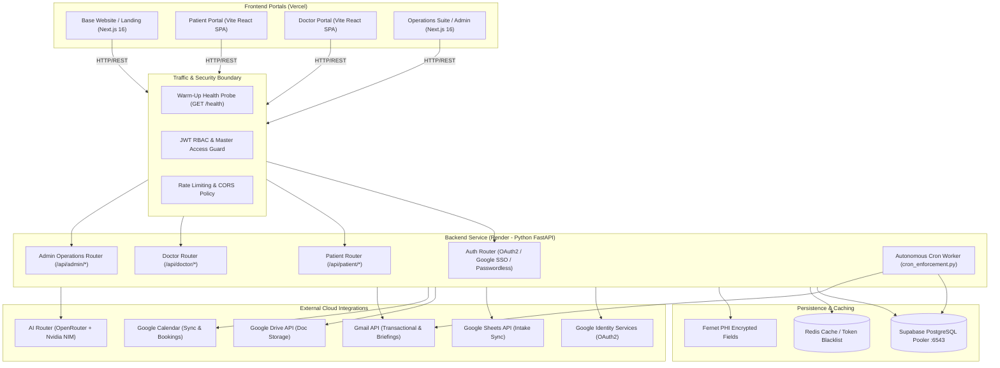
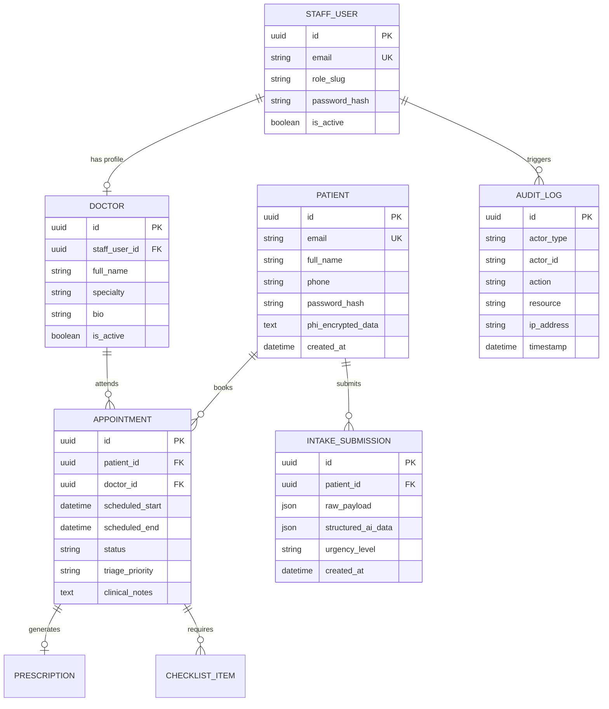

# Alder & Sage Medical Intake Platform — System Architecture & Technical Blueprint

> **Engineering Reference & Technical Interview Master Guide**  
> **Production Status:** Fully Verified & Deployed (Render Backend + Vercel Multi-Portal + Supabase PostgreSQL + Google Cloud APIs)

---

## 1. Executive Summary & Architectural Overview

**Alder & Sage** is a production-grade, HIPAA-conscious medical concierge intake and multi-portal clinic orchestration platform. It streamlines the patient lifecycle from initial landing and appointment scheduling to autonomous clinical AI triage, doctor consultation workflows, and real-time operations auditing.

### System Topology Diagram


---

## 2. Frontend Multi-Portal Architecture

The client tier is split into four distinct sub-projects hosted collectively on Vercel:

| Sub-Project | Framework | Bundler | Target Role | URL Path |
| :--- | :--- | :--- | :--- | :--- |
| **Base Website** | Next.js 16 (App Router) | Turbopack | Public / Prospects | `/` and `/home` |
| **Patient Portal** | React 18 + Tailwind | Vite (Singlefile) | Verified Patients | `/patient-dashboard` |
| **Doctor Portal** | React 18 + Tailwind | Vite (Singlefile) | Clinicians / Physicians | `/doctor-dashboard` |
| **Operations Suite** | Next.js 16 (App Router) | Turbopack | Practice Admin / Ops | `/admin-dashboard` |

### Key Frontend Architectural Patterns
1. **Cold-Start Elimination (Render Backend Wake-up):**
   - Free/starter tier cloud instances (Render) sleep after inactivity.
   - `AuthProvider.tsx` fires a background `pingBackend()` (`GET /health`) on component mount.
   - Primary landing page call-to-action buttons ("Book Appointment", "Explore Services") fire proactive wake-up pings on hover and pointerdown, masking cold-start latencies before user form submission.
2. **URL Normalization & Trailing-Slash Sanitization:**
   - All API client wrappers apply `.replace(/\/+$/, "")` to `NEXT_PUBLIC_API_URL` to guarantee clean URL string interpolation across Next.js and Vite micro-frontends without `//` routing faults.
3. **Unified Single-Sign-On Callback Handler:**
   - `/auth/callback` catches OAuth tokens and query parameters, inspects user roles, and seamlessly redirects patients to `/patient-dashboard`, doctors to `/doctor-dashboard`, or admins to `/admin-dashboard`.

---

## 3. Backend Architecture & API Layer

The core application is constructed with **FastAPI** (Python 3.12) running under an asynchronous ASGI concurrency loop.

### Authentication & RBAC Hierarchy
Authentication is backed by signed cryptographic **JWTs** (JSON Web Tokens) with distinct sub-claims and role scopes:
- **Patient Token:** Carries `patient_id` in subject claims; scoped strictly to patient self-service endpoints.
- **Staff / Doctor Token:** Carries `staff_id`, `role: "doctor"`, and required foreign key `doctor_id`.
- **Admin Token:** Carries `staff_id` and `role: "admin"`.
- **Master Admin Account (`hospitalbookingsystem.0512@gmail.com`):**
  - Universally privileged identity defined via `is_master_account()`.
  - Automatically provisions and synchronizes `Patient`, `StaffUser`, and `Doctor` database entities upon Google OAuth login.
  - Transparently satisfies `require_admin`, `require_staff_doctor`, and `get_current_patient` security dependencies, enabling end-to-end multi-portal administrative auditing and review without credential switching.

### API Router Breakdown
```text
backend/
├── api/
│   ├── routes.py      # Auth, Google OAuth2 callback, health check, public intake
│   ├── patient.py     # Appointments, prescriptions, checklist, medical records
│   ├── doctor.py      # Patient queues, clinical notes, appointment status update
│   ├── admin.py       # Operations suite, health probes, staff CRUD, CSV audit exports
│   └── webhooks.py   # Gmail watch hooks, Calendly verification (HMAC-SHA256)
├── core/
│   ├── security.py    # JWT issue/verify, bcrypt password hashing, master admin bypass
│   ├── database.py    # Async SQLAlchemy engine & session maker
│   └── config.py      # Pydantic BaseSettings environment parsing
└── models/
    └── models.py      # SQLAlchemy declarative schemas & enums
```

---

## 4. Data Layer & Database Schema

The persistence layer connects to **Supabase PostgreSQL** through its transaction pooler on port `6543`, supporting high-concurrency connection reuse without hitting PostgreSQL process limits.

### Core Entity Relationship (ER) Model


### Security & Privacy Controls
- **PHI Encryption:** Sensitive patient medical records and intake submissions are encrypted at rest using AES-CBC / Fernet (`PHI_ENCRYPTION_KEY`) before persisting to disk/database columns.
- **Audit Logging:** Every administrative read, modification, and export is recorded immutably in the `AuditLog` table with timestamp, actor email, IP address, and operation payload.

---

## 5. Autonomous AI Triage & Parsing Engine

The system uses an autonomous clinical ingestion pipeline designed with dual-model redundancy:

1. **Intake Ingestion:** Patient completes structured and open-ended symptom questionnaires on the landing page or patient portal.
2. **Model Router:**
   - **Primary Engine:** OpenRouter (accessing DeepSeek V3 / Claude 3.5 Sonnet / GPT-4o-mini).
   - **Secondary Engine (Fallback):** Nvidia NIM (llama-3.1-70b-instruct).
   - If the primary provider times out, returns HTTP 429, or fails schema validation, the router seamlessly falls back to the secondary model with exponential backoff.
3. **Structured Entity Extraction:**
   - Raw free-form complaints are converted into structured Pydantic models:
     - Chief Complaint
     - Severity Score (1-10)
     - Red Flag Clinical Symptoms (e.g., chest pain, shortness of breath, acute neurological deficits)
     - Urgency Classification: `EMERGENT`, `URGENT`, `ROUTINE`
4. **Autonomous Action Dispatching:**
   - If flagged as `EMERGENT` or `URGENT`:
     - System alerts practice staff via the Gmail API.
     - Logs record directly to the priority triage queue in Google Sheets.
     - Automatically flags the patient record for immediate doctor review before the scheduled consultation.

---

## 6. External Cloud Integrations

| Provider | Service / API | Integration Purpose | Implementation Mechanism |
| :--- | :--- | :--- | :--- |
| **Google Cloud** | Google Sheets API | Real-time intake mirror & tabular clinical audit log | Service Account key via environment variable `GOOGLE_SERVICE_ACCOUNT_JSON` |
| **Google Cloud** | Google Drive API | Archival of intake summaries and clinical PDFs | Service Account scoped to clinic shared drive folder |
| **Google Cloud** | Google Calendar API | Doctor schedule synchronization & slot reservation | Service Account two-way sync with doctor calendar IDs |
| **Google Cloud** | Gmail API | Patient appointment confirmations, 24h reminders, and automated doctor daily briefings | OAuth2 Refresh Token (`GMAIL_REFRESH_TOKEN`) with auto-refreshing access tokens |
| **Supabase** | Managed PostgreSQL | Relational storage with Transaction Pooling | Async SQLAlchemy + `asyncpg` over SSL |

---

## 7. Autonomous Cron Worker (`cron_enforcement.py`)

A background daemon executes scheduled healthcare workflow policies idempotently:
1. **48-Hour Warning Job:** Identifies upcoming consultations where mandatory intake documentation has not been completed; dispatches automated follow-up reminders.
2. **24-Hour Visit Briefing Job:** Compiles appointment summaries and autonomous AI triage briefings for attending physicians.
3. **Auto-Cancellation Safeguard:** Flags or releases expired reservations that failed verification within policy windows.

---

## 8. Technical Interview Preparation (Cheat Sheet & Q&A)

### Q1: "How do you handle role separation and authorization across your portals?"
> **Answer:**  
> "We implement a strict Role-Based Access Control (RBAC) architecture using signed cryptographic JWTs validated through FastAPI dependency injection guards (`require_admin`, `require_staff_doctor`, and `get_current_patient`).  
> Tokens carry explicit claims (`role`, `patient_id`, and `doctor_id`). For doctor-specific actions, the route checks not just the role string but verifies the presence of an active `doctor_id` foreign key.  
> Furthermore, we established a deterministic Master Admin pattern for cross-portal auditing, where authorized administrative credentials bypass role locks while automatically ensuring underlying user profiles exist across all clinical tables."

### Q2: "How do you protect Protected Health Information (PHI) under HIPAA guidelines?"
> **Answer:**  
> "We apply defense-in-depth across three layers:  
> 1. **At Rest:** Sensitive medical history and intake payloads are encrypted using AES-128-CBC/Fernet symmetric encryption before insertion into PostgreSQL.  
> 2. **In Transit:** All external traffic is enforced over TLS/HTTPS; Supabase database connections use enforced SSL pooling (`sslmode=require`).  
> 3. **Auditability:** Every read, update, or data export operation writes an immutable event to the `AuditLog` table capturing timestamp, actor identity, action type, and client IP."

### Q3: "How do you solve cold starts on serverless or low-cost container platforms?"
> **Answer:**  
> "Render's starter tier spins down inactive web services. We solved this on the frontend using proactive warm-up triggers:  
> When any client lands on the root site, an `AuthProvider` `useEffect` dispatches an unauthenticated `GET /health` request to wake the container. Additionally, primary user interaction points ('Book Appointment', 'Services') execute pointer-down and hover pings to ensure the server is hot before form completion."

### Q4: "Why use Supabase Transaction Pooler (port 6543) instead of direct PostgreSQL (port 5432)?"
> **Answer:**  
> "FastAPI uses an asynchronous event loop with asyncpg. Under sudden traffic spikes or concurrent client requests, opening new direct PostgreSQL connections can quickly exhaust connection limits. Supabase's transaction pooler (powered by PgBouncer) maintains a lean pool of physical database connections while multiplexing hundreds of short-lived client transactions, guaranteeing low connection overhead and zero connection exhaustion errors."

### Q5: "What happens if your primary AI provider (OpenRouter) experiences downtime or rate limits?"
> **Answer:**  
> "We implemented an AI Model Router featuring automated failover. The router tries the primary provider (OpenRouter with DeepSeek/Claude) and handles HTTP 429, timeouts, and JSON schema parsing errors by immediately retrying against our secondary Nvidia NIM provider (Llama-3.1-70b-instruct). This ensures patient intake workflows never block on single-provider outages."
