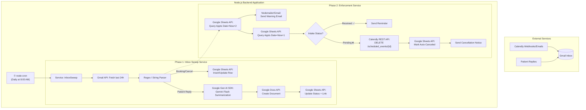

# System Architecture

## 1. High-Level Concept
The system is built as a **Node.js/TypeScript Backend Service**. It acts as a headless, event-driven cron worker. Instead of polling heavy external APIs constantly, it uses the clinic's Gmail inbox as a lightweight event queue, processing changes daily, executing strict 3-day enforcement rules, and maintaining a Google Sheet as its primary database.

## 2. Architecture Diagram

## 3. Core Modules
- **`src/cron.ts`**: The main entry point initializing `node-cron` schedules.
- **`src/services/gmail.service.ts`**: Handles fetching unread emails and sending outbound templates.
- **`src/services/calendly.service.ts`**: Handles the HTTP DELETE requests to remove non-compliant bookings.
- **`src/services/sheets.service.ts`**: Acts as the ORM, abstracting the Google Sheets API to read/write appointment rows.
- **`src/services/ai.service.ts`**: Wraps the `@google/generative-ai` SDK to enforce the strict medical prompt.
